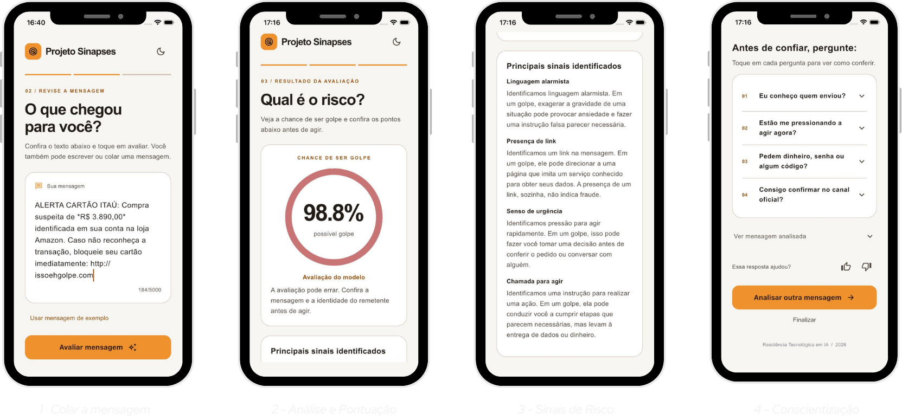

# Sinápses — MVP de análise de mensagens suspeitas

O **Sinápses** é um protótipo de aplicativo que ajuda a pessoa a avaliar mensagens SMS potencialmente fraudulentas. A pessoa cola uma mensagem, recebe uma pontuação produzida por um classificador e vê sinais que merecem atenção, acompanhados de perguntas para incentivar uma decisão mais cuidadosa.

> **Importante:** o resultado é uma estimativa do modelo, não uma confirmação de golpe ou de segurança. Uma mensagem legítima pode ser classificada como suspeita, e uma fraude pode passar despercebida. Confira solicitações por canais oficiais e não use a pontuação como única base para decidir.

## Como funciona

1. A pessoa cola o texto da mensagem no aplicativo.
2. O aplicativo Flutter envia o texto à API local em Python.
3. A API extrai atributos estruturados, calcula indicadores de agrupamento e executa o classificador treinado.
4. A interface apresenta a pontuação, os sinais destacados e perguntas de reflexão antes de confiar na mensagem.

### Telas do protótipo



*Da esquerda para a direita: colar a mensagem, análise e pontuação, sinais de risco e perguntas de conscientização. A porcentagem mostrada na tela é um exemplo de análise individual, não uma métrica geral de desempenho.*

## Tecnologias

- **Aplicativo:** Flutter e Dart.
- **API:** Python e FastAPI.
- **Classificação:** XGBoost.
- **Representação textual:** embeddings do modelo `sentence-transformers/paraphrase-multilingual-MiniLM-L12-v2`.
- **Agrupamento auxiliar:** TF-IDF e K-means, com seis indicadores de cluster.
- **Extração de sinais:** regras para atributos da mensagem e verificação gramatical local com LanguageTool.

O modelo combina 384 dimensões de embedding, 22 atributos estruturados e seis indicadores de cluster, totalizando **412 valores de entrada**. A decisão de classe usa o limiar configurado de **0,55**.

## Estrutura do repositório

```text
.
├── frontend/                 # Aplicativo Flutter e projetos de plataforma
│   └── lib/
│       ├── main.dart         # Interface principal
│       └── api.dart          # Comunicação com a API
├── backend/
│   ├── api/                  # Endpoints, serviço e inferência
│   ├── extrator_features/    # Extração dos 22 atributos
│   ├── modelos/v1/           # Artefatos pequenos do modelo
│   ├── tests/                # Testes automatizados da API e do fluxo
│   ├── requirements.txt
│   └── requirements-dev.txt
├── inicializacao/            # Preparação e inicialização do MVP
├── Iniciar Web.command
└── Iniciar iPhone.command
```

Documentação específica:
- [Aplicativo Flutter](frontend/README.md)
- [API, extração e modelo](backend/README.md)

## Executar localmente

### Requisitos

- Python 3.12
- Java 17 ou superior
- Flutter compatível com Dart 3.13.2
- Para executar o simulador de iPhone: macOS e Xcode com o simulador configurado
- No macOS, se o XGBoost não encontrar OpenMP, instale a dependência com `brew install libomp`.

### Preparação inicial

Na raiz do projeto, execute:

```bash
bash inicializacao/preparar.sh
```

Esse processo cria o ambiente Python, instala as dependências, prepara o encoder e o LanguageTool local e baixa as dependências do Flutter. A primeira preparação precisa de internet e pode levar algum tempo, principalmente por causa do modelo de embeddings.

### Iniciar no navegador

```bash
bash inicializacao/iniciar.sh web
```

Depois, abra [http://localhost:8080](http://localhost:8080). O script inicia a API e o aplicativo, escolhe uma porta disponível entre 8000 e 8010 para a API e encerra os processos com `Ctrl+C`.

Também é possível abrir `Iniciar Web.command` no macOS.

### Iniciar no simulador de iPhone

```bash
bash inicializacao/iniciar.sh iphone
```

Ou abra `Iniciar iPhone.command` no macOS. É necessário ter o Xcode e um simulador configurados.

Para fixar a porta da API, por exemplo:

```bash
API_PORT=8001 bash inicializacao/iniciar.sh web
```

As instruções para Android, dispositivo físico e execução direta do Flutter estão em [frontend/README.md](frontend/README.md) e [backend/README.md](backend/README.md).

## API resumida

| Método | Rota | Finalidade |
|---|---|---|
| `GET` | `/saude` | Informa o estado dos componentes e a disponibilidade da classificação. |
| `POST` | `/extrair` | Extrai atributos e indicadores de cluster sem retornar a classificação final. |
| `POST` | `/analisar` | Extrai os sinais e retorna a pontuação e a classe calculadas pelo modelo. |

As rotas `POST` recebem JSON no formato `{"mensagem": "texto da mensagem"}`. O texto deve conter de 1 a 5.000 caracteres úteis; entradas vazias ou acima do limite são rejeitadas.

## Avaliação e limitações

Na apresentação do projeto, o modelo foi avaliado em um conjunto de teste de 219 mensagens. A matriz de confusão registrada foi: 124 verdadeiros negativos, 2 falsos positivos, 10 falsos negativos e 83 verdadeiros positivos. A partir desses valores, a acurácia é **94,52%**, a precisão **97,65%**, o recall **89,65%** e o F1-score aproximadamente **93,26%**.

Porém, esses números descrevem o conjunto de teste utilizado, não garantem o mesmo desempenho em mensagens encontradas no mundo real. 

Outras limitações relevantes:

- A classificação pode produzir falsos positivos e falsos negativos.
- Os sinais exibidos são descrições fixas associadas a atributos detectados; não são explicações geradas por IA nem comprovam fraude por si só.
- As contribuições de atributos apresentadas pelo backend não representam porcentagens de probabilidade e não explicam sozinhas toda a decisão do modelo.
- O feedback de polegar é apenas local na interface: não é persistido e não retreina o modelo.
- O projeto é um MVP e não deve ser tratado como mecanismo definitivo de segurança ou substituto da verificação por canais oficiais.

## Privacidade e processamento

A inferência foi preparada para usar localmente os componentes necessários, sem enviar o texto da mensagem a serviços externos durante a análise. A preparação inicial baixa dependências de software e o modelo de embeddings. Evite expor mensagens privadas em capturas de tela, issues ou logs compartilhados.


## Testes

Com o ambiente preparado, execute os testes do backend e do Flutter:

```bash
cd backend
.venv/bin/python -m pip install -r requirements-dev.txt
PYTHONPATH=. .venv/bin/python -m pytest tests/test_01_fluxo.py -q

cd ../frontend
flutter test
```

Os testes do backend cobrem validação do texto, contrato dos atributos, classificação com o modelo carregado, codificação das features e CORS local. Os testes do Flutter cobrem a comunicação com a API e componentes da interface.

## Informações adicionais
- **Contexto:** O Sinápses foi desenvolvido como parte do First Challenge da Residência em Inteligência Artificial, uma iniciativa do Instituto Eldorado em parceria com a PUC Campinas.
- **Objetivo:** O projeto teve como objetivo desenvolver e aplicar conhecimentos de Inteligência Artificial no desenvolvimento de uma solução para um problema real.
- **Status:** MVP Concluído e Apresentado (com possibilidades de continuidade).
- **Ano:** 2026.

## Autores

- **Álvaro Santos de Almeida**
- **Bruno Henrique de Almeida Lima**
- **Lucas Soares Gonçalves**
- **Leonid H. Mamani**  
- **Maria Clara Rodrigues da Silva**
- **Vicente Matheus Collin Pedroso**  

